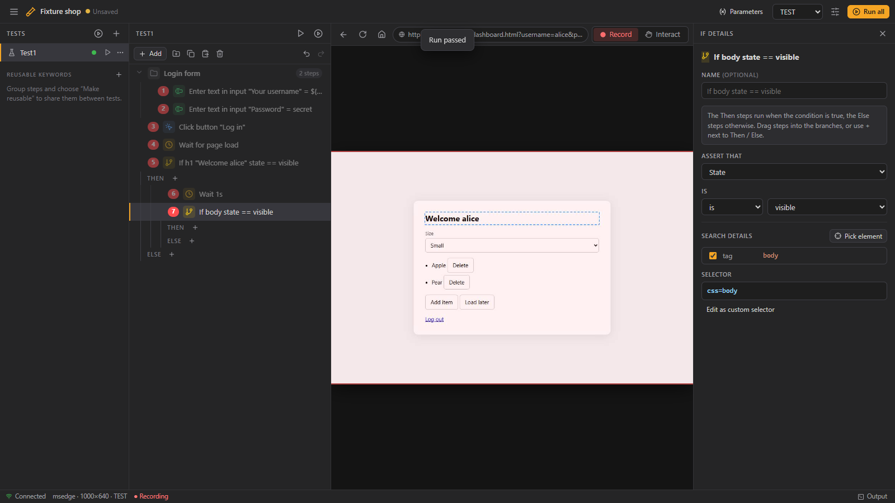

# UITester

Build, maintain and run UI tests by clicking through your application. Every project is saved as plain
[Robot Framework](https://robotframework.org) files (Browser library), so the tests also run without UITester.



Tests · Steps · live Browser view · Details. Dark, Bruno-style UI with a hamburger menu for projects and settings.

## Quick start

```sh
npm install
npm run build          # UI + bundled CLI
npm start -- <project-folder>
```

Development (Vite with hot reload, one port): `npm run dev -- <project-folder>`.

Try it with the bundled fixture site:

```sh
npm run fixtures                              # http://127.0.0.1:4400
npm run sample -- C:\temp\fixture-project     # writes a sample project
npm start -- C:\temp\fixture-project
```

### Robot Framework

Running `.robot` files needs Python 3 with `robotframework`, `robotframework-browser` (+ `rfbrowser init`) and,
for parallel runs, `robotframework-pabot`. **Project settings → Robot Framework** checks this and can install
everything into a `.venv` in the project folder. Python is looked up in this order: app setting,
`$UITESTER_PYTHON`, a `.venv` in the project folder or any parent, `python` on `PATH`.

## Using it

- **Record**: in Record mode a click in the browser view adds an event (red outline + order number on the page).
  **Interact** mode lets you use the page normally (log in, navigate) without recording.
- **Details** (right column): Action or Assertion, the search properties used to find the element (with a live
  “finds 0 / 1 / n elements” check and dashed outlines for extra matches), action/assert settings, `${PARAM}` values.
- **Add** menu: wait (time, page load, element), pause, screenshot, if statement (nested), group, Robot code,
  reusable keywords.
- **Groups**: select steps (Ctrl/Shift-click) → Ctrl+G. Copy/paste them between tests (Ctrl+C / Ctrl+V).
  *Make reusable* turns a group into a linked keyword shared by all tests (edit it once, it changes everywhere).
- **Run**: ▶ in the steps column runs the selection or the whole test inside the app (pause → Continue button).
  ▶ next to a test, or **Run all**, runs Robot Framework itself; output, PASS/FAIL and the log are shown at the bottom.
- **Parameters** (top bar): name + a value per environment (DEV/TEST/ACC/PROD); `URL` is required. Tests can
  override parameters (shown with a warning) in *Test settings*, along with happy/unhappy and smoke/regression.
- **Project settings**: browser (Chrome, Edge, Firefox), headless, resolution, timeout, retries, environment,
  screenshot folder and the **run plan** (stages run in series, tests within a stage in parallel).

Saving is automatic (Ctrl+S saves immediately; Ctrl+Z / Ctrl+Y undo/redo). Logs of every run are kept in `logs/`.

## Project folder

```
uitester.json                 source of truth for UITester (steps, recorded element details, settings)
tests/<Test>.robot            one suite per test, tagged with flow and kind
resources/keywords.resource   reusable groups (linked keywords)
resources/uitester.resource   browser setup; override with -v BROWSER:firefox -v HEADLESS:True ...
resources/UITesterLib.py      Pause For Key
env/DEV.py … env/PROD.py      parameter values per environment
run.bat / run.sh              run everything:  run.bat PROD -v HEADLESS:True
run_parallel.bat, run_plan.txt   run plan for pabot
screenshots/  logs/
```

If a generated file was edited by hand, UITester notices on open and offers to load the changes. Opening a folder
without `uitester.json` imports its Robot files: known Browser keywords become steps, anything else is kept as a
Robot code step.

## Command line

```sh
uitester [project-folder] [--port 4321] [--no-open]
uitester run [project-folder] [--tests "Login,Checkout"] [--env PROD] [--headless] [--serial]
```

`uitester run` exits with 0 when all tests pass, which makes it usable in CI.

## Architecture

One TypeScript codebase (npm workspaces):

| package | role |
| --- | --- |
| `packages/core` | project model (zod), Robot generator and importer, selectors, step-tree helpers. No Node/browser APIs (fs lives in `core/node`). |
| `packages/engine` | Playwright browser session (screencast, input, overlay), live runner, robot/pabot runner, Python checks. |
| `packages/server` | HTTP + WebSocket API over core + engine; serves the UI. |
| `packages/ui` | React UI. |
| `packages/cli` | `uitester` command; `npm run build` bundles everything into `packages/cli/dist` for npx. |
| `packages/vscode`, `packages/electron` | thin shells that host the same server + UI. |
| `packages/fixtures` | demo site and sample project used by the tests. |

`npm test` runs unit tests and end-to-end tests (real browser via installed Edge/Chrome; Robot tests run when
Robot Framework is available).
